<div align="center">

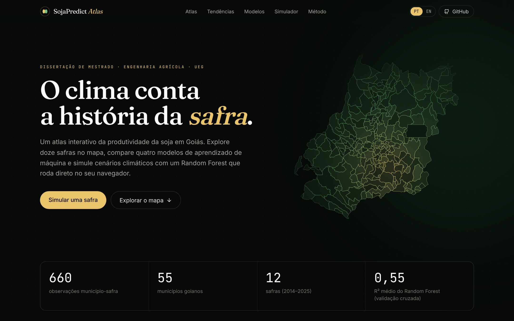

# SojaPredict Atlas

**Atlas interativo da produtividade da soja em Goiás, com machine learning rodando no navegador**

[](https://gabrielsallessi.github.io/sojapredict-atlas/)
[](https://gabrielsallessi.github.io/sojapredict-atlas/?lang=en)
[](https://github.com/gabrielSallesSi/sojapredict-atlas/actions/workflows/deploy.yml)


[Português](#sobre) · [English](#english)

</div>

---

## Sobre

O **SojaPredict Atlas** é a vitrine web da dissertação de mestrado *"Previsão da produtividade da soja em Goiás por aprendizado de máquina: desenvolvimento de um sistema computacional de apoio à decisão"* (Programa de Pós-Graduação em Engenharia Agrícola, Universidade Estadual de Goiás).

O site reúne **660 observações** (55 municípios × 12 safras, de 2013/14 a 2024/25) de produtividade e clima. Nele dá para:

- explorar no mapa a evolução da produtividade, da chuva e da temperatura, município a município;
- ver tendências regionais e correlações entre clima e rendimento;
- comparar quatro algoritmos de machine learning com validação cruzada e testes estatísticos;
- **simular cenários climáticos** com um Random Forest que roda **inteiramente no navegador**, sem servidor nem API.

Tudo é estático: o site é hospedado de graça no GitHub Pages e também funciona na Vercel.

## Demonstração

### Atlas: doze safras no mapa

Ao apertar o play, o mapa percorre as safras de 2014 a 2025. Dá para trocar a variável (produtividade, chuva ou temperatura máxima) e clicar em um município para ver a trajetória dele, a posição no estado e o top 5 da safra.

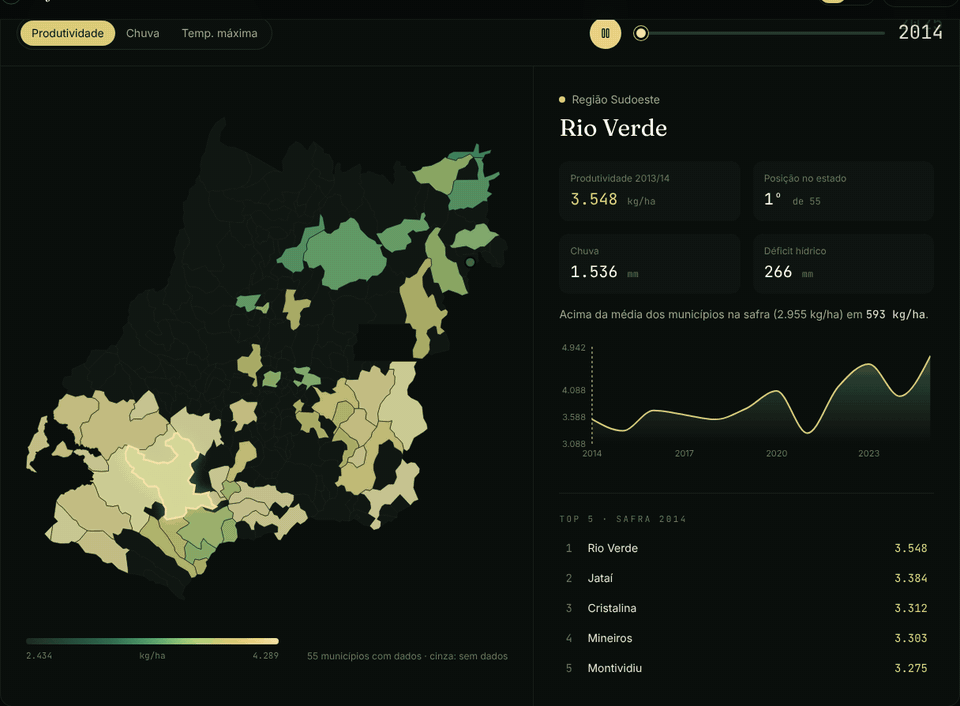

### Tendências e correlações

Produtividade média por região (com legenda clicável para ocultar regiões), dispersão de chuva, déficit hídrico ou temperatura contra a produtividade, e o coeficiente de Pearson de cada variável.

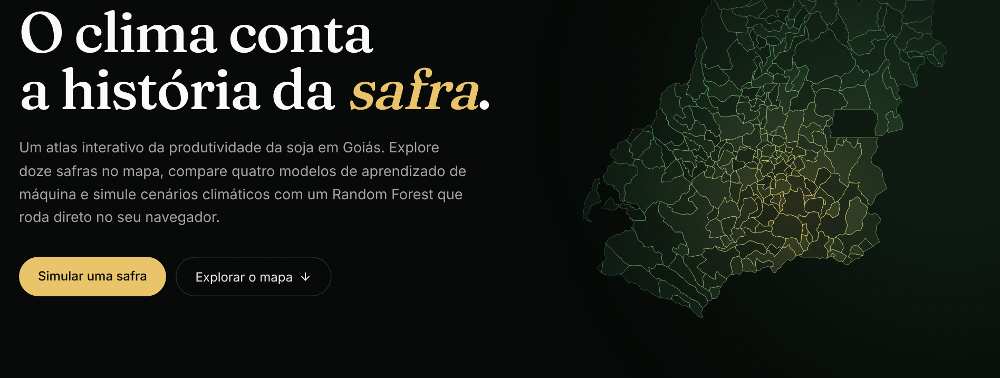
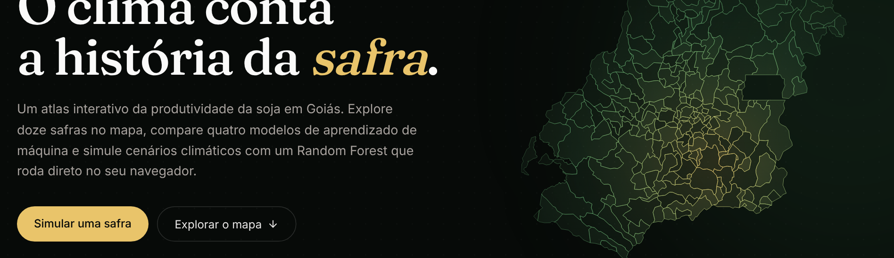

### Comparação de modelos

Os resultados dos quatro modelos da dissertação, a matriz do teste de Diebold-Mariano e a importância das variáveis no Random Forest.

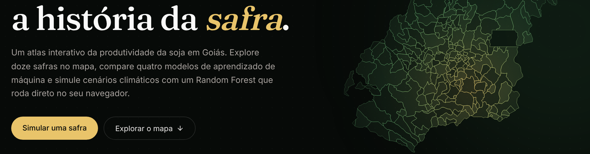
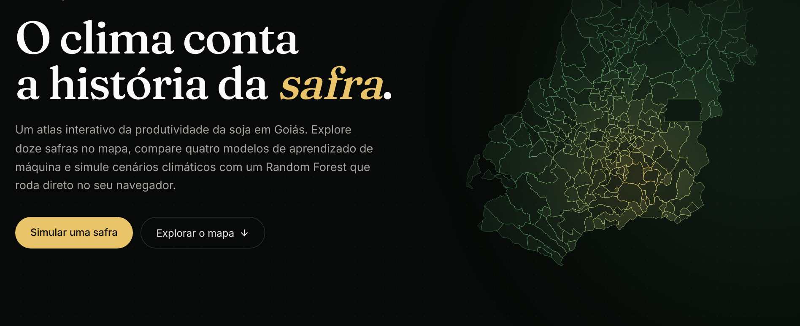

### Simulador climático (ML no navegador)

Basta escolher um município e partir da média histórica, do ano mais seco ou do ano mais chuvoso dele. Os sliders de chuva, temperaturas e umidade mudam a previsão na hora. A curva mostra como a produtividade prevista responde à chuva, com a faixa entre os percentis 10 e 90 das árvores.

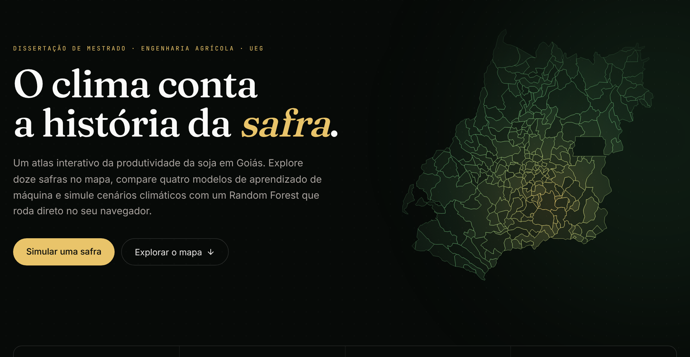
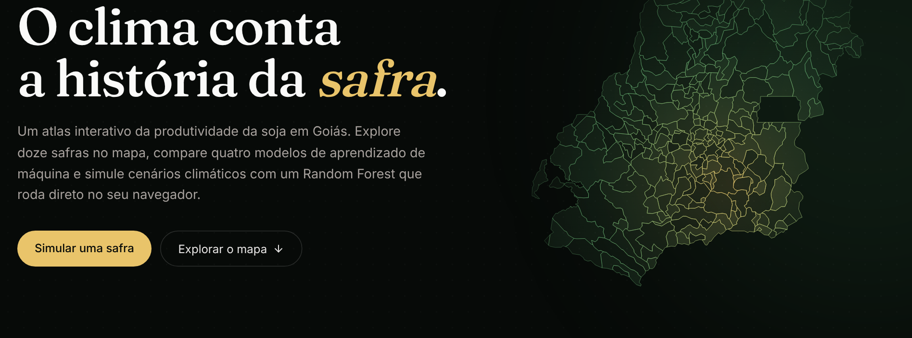

### Responsivo e bilíngue

O layout funciona em celular. O idioma (PT-BR ou EN) é escolhido no menu: o site detecta o idioma do navegador, lembra a escolha do visitante e aceita links diretos com `?lang=en` ou `?lang=pt`.

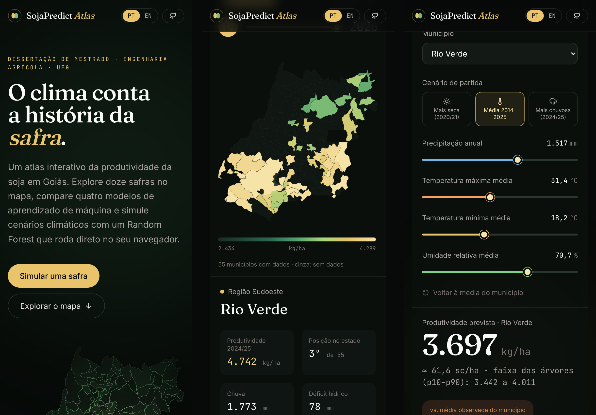

<details>
<summary>Versão em inglês</summary>
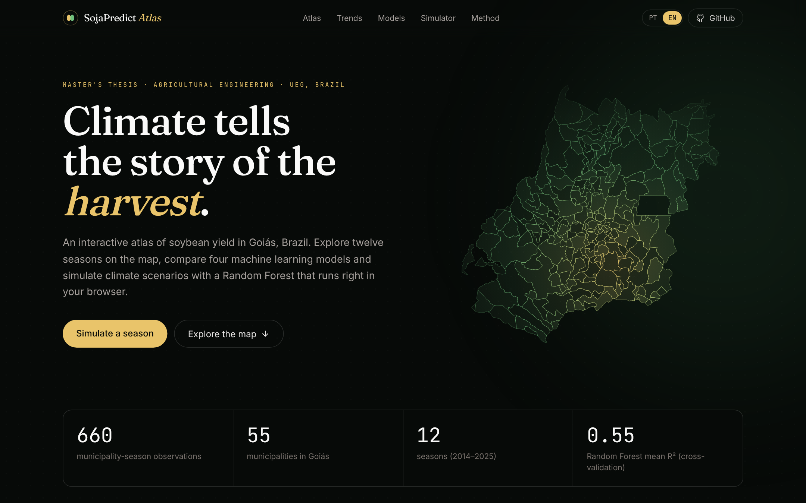
</details>

## Resultados da dissertação

Validação cruzada com 14 variáveis climáticas e de balanço hídrico (valores de `results/` da dissertação):

| Modelo | R² (média ± dp) | RMSE (kg/ha) | MAE (kg/ha) | MAPE no teste |
|---|---|---|---|---|
| Regressão Linear | 0,467 ± 0,095 | 331,5 | 265,5 | 7,63% |
| **Random Forest** | **0,551 ± 0,072** | **304,5** | **242,2** | **6,88%** |
| XGBoost | 0,530 ± 0,094 | 310,5 | 244,5 | 6,92% |
| Rede Neural MLP | 0,432 ± 0,147 | 342,5 | 267,3 | 7,85% |

Pelo teste de Diebold-Mariano, Random Forest (p < 0,001) e XGBoost (p = 0,003) superam a regressão linear, mas não diferem entre si (p = 0,117). As variáveis ligadas à água (evapotranspiração real, precipitação, índice de aridez e déficit hídrico) lideram a importância no Random Forest.

## Como o ML roda no navegador

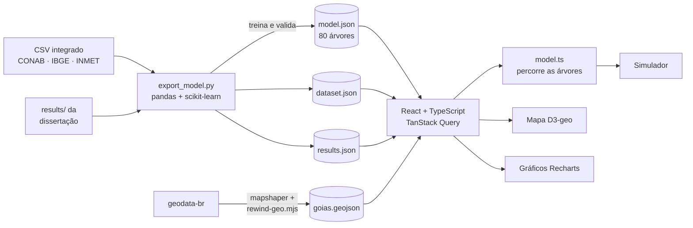

1. **Treino em Python.** `scripts/export_model.py` treina um `RandomForestRegressor` compacto (80 árvores, profundidade máxima 10) e exporta cada árvore como vetores simples: `feature`, `threshold`, `left`, `right` e `value`.
2. **Inferência em TypeScript.** `src/lib/model.ts` percorre cada árvore até a folha e tira a média, exatamente como o `predict` do scikit-learn. A comparação usa `Math.fround` para reproduzir a precisão `float32` do scikit-learn.
3. **Garantia por teste.** `src/lib/model.test.ts` (Vitest) confirma que as previsões no navegador batem com as do Python, com diferença menor que 1 kg/ha. O teste roda a cada deploy.

O modelo do navegador usa 6 entradas (latitude, longitude, temperaturas máxima e mínima, precipitação e umidade), para que o visitante possa mexer diretamente no clima:

| Validação | R² | RMSE (kg/ha) | MAE (kg/ha) |
|---|---|---|---|
| KFold 5 (aleatório) | 0,569 | 303,8 | 238,6 |
| GroupKFold 5 (por município) | 0,559 | 307,1 | 240,6 |

O desempenho é equivalente ao do Random Forest completo da dissertação. A validação por município mostra que o modelo generaliza para locais que não viu no treino.

## Stack

| Camada | Tecnologias |
|---|---|
| Interface | React 18, TypeScript (strict), Vite 5 |
| Estilo e animação | Tailwind CSS, Framer Motion, fontes Fraunces, Inter e JetBrains Mono |
| Visualização | D3-geo (projeção do mapa), D3-scale (escalas de cor), Recharts |
| Estado e dados | Zustand (estado global e idioma), TanStack Query (carregamento dos JSONs) |
| Internacionalização | Dicionário tipado próprio (PT-BR / EN) com `Intl.NumberFormat` |
| Qualidade | Vitest, `tsc --strict`, verificação visual com Playwright |
| Ciência de dados | Python, pandas, scikit-learn |
| Deploy | GitHub Actions + GitHub Pages; compatível com Vercel |

## Estrutura

```
├── .github/workflows/deploy.yml   # CI: testes, build e publicação no Pages
├── docs/img/                      # imagens deste README
├── public/data/
│   ├── dataset.json               # 660 linhas município-safra
│   ├── results.json               # métricas e testes da dissertação
│   ├── model.json                 # Random Forest exportado (~430 kB)
│   └── goias.geojson              # 246 municípios simplificados (~115 kB)
├── scripts/
│   ├── export_model.py            # treina, valida e exporta o modelo e os dados
│   └── rewind-geo.mjs             # corrige a orientação dos polígonos para o D3
└── src/
    ├── components/                # mapa, navegação, sliders, tooltips
    ├── sections/                  # Hero, Atlas, Tendências, Modelos, Simulador, Método
    └── lib/
        ├── model.ts               # inferência do Random Forest
        ├── model.test.ts          # paridade com o scikit-learn
        ├── i18n.ts                # traduções PT-BR / EN
        ├── data.ts                # hooks de dados (TanStack Query)
        └── store.ts               # estado do atlas (Zustand)
```

## Rodar localmente

Requer Node.js 20 ou mais recente.

```bash
git clone https://github.com/gabrielSallesSi/sojapredict-atlas.git
cd sojapredict-atlas
npm install
npm run dev        # http://localhost:5173
npm test           # paridade do modelo com o scikit-learn
npm run build      # gera dist/
```

### Regenerar dados e modelo

Os JSONs em `public/data/` já vêm prontos. Para refazer a partir dos dados da dissertação:

```bash
pip install pandas scikit-learn
python scripts/export_model.py \
  --data caminho/para/dataset_integrado_soja_go_2014_2024.csv \
  --results caminho/para/results
```

## Deploy

- **GitHub Pages:** automático. Cada push na `main` dispara `.github/workflows/deploy.yml`, que instala, testa, compila e publica.
- **Vercel:** importe o repositório e a Vercel usa o `vercel.json`. O build usa caminhos relativos, então o mesmo `dist/` funciona na raiz de um domínio ou em um subcaminho como `/sojapredict-atlas/`.

## Fontes dos dados

- Produtividade: CONAB (levantamentos de safra), IBGE/PAM e SEAPA-GO
- Clima: INMET (normais climatológicas 1991–2020 e anomalias)
- Balanço hídrico: método de Thornthwaite-Mather, calculado na dissertação
- Malha municipal: [tbrugz/geodata-br](https://github.com/tbrugz/geodata-br), a partir do IBGE

---

## English

**SojaPredict Atlas** is the web showcase of a master's thesis on **soybean yield prediction in Goiás, Brazil, using machine learning** (Agricultural Engineering, State University of Goiás, UEG).

- **Animated choropleth map** of 55 municipalities across 12 seasons (2014–2025), switchable between yield, rainfall and max. temperature
- **Interactive charts** of regional trends, climate × yield scatter plots and Pearson correlations
- **Comparison of four models** (Linear Regression, Random Forest, XGBoost, MLP) with cross-validation and Diebold-Mariano tests. Random Forest scored best (CV R² 0.551 ± 0.072, RMSE 304.5 kg/ha)
- **In-browser ML:** an 80-tree Random Forest trained in scikit-learn, exported to JSON and evaluated in TypeScript, with a Vitest suite confirming parity with Python (< 1 kg/ha difference). Out-of-sample R² is 0.57 with random 5-fold CV and 0.56 with 5-fold CV grouped by municipality
- **Bilingual** (PT-BR / EN), responsive, fully static and deployed to GitHub Pages through GitHub Actions

**Live:** https://gabrielsallessi.github.io/sojapredict-atlas/?lang=en

```bash
npm install && npm run dev
```

---

<div align="center">

**Gabriel Sá da Silveira** · M.Sc. em Engenharia Agrícola (UEG)<br/>
Orientação: Prof. Dr. Francisco Ramos de Melo

[LinkedIn](https://www.linkedin.com/in/gabriel-s%C3%A1-da-silveira-1298ab201/) · [GitHub](https://github.com/gabrielSallesSi)

</div>
